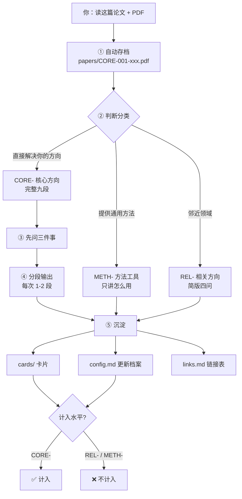
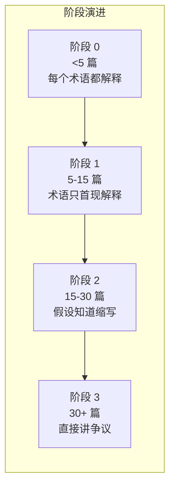

# 核心设计图（可直接放进 README）

> 全部使用 ASCII / Mermaid，GitHub 原生渲染，无需图片。

---

## 一、整体流程图

```
┌──────────────────────────────────────────────────────────────┐
│                      你：读这篇论文 + PDF                      │
└──────────────────────────────────────────────────────────────┘
                              ↓
┌──────────────────────────────────────────────────────────────┐
│  ① 自动存档                                                   │
│     papers/CORE-001-xxx.pdf   ← 原文落地，对话断了也不丢       │
└──────────────────────────────────────────────────────────────┘
                              ↓
┌──────────────────────────────────────────────────────────────┐
│  ② 判断分类（三类之一）                                        │
│                                                              │
│     直接解决你的方向  →  CORE-   完整九段，深度讲              │
│     邻近领域有借鉴    →  REL-    简版四问，快速过              │
│     通用方法/工具     →  METH-   只讲"能怎么用"                │
└──────────────────────────────────────────────────────────────┘
                              ↓
┌──────────────────────────────────────────────────────────────┐
│  ③ 先问三件事（不直接开讲）                                     │
│                                                              │
│     想干什么？  快速筛 / 精读 / 深挖 / 找创新 / 补基础 / 汇报   │
│     要多深？    入门（跳数学）/ 标准 / 硬核（推导也拆）         │
│     先看哪块？  从头 / 方法 / 实验 / 创新点 / 可借鉴 / 弱点     │
└──────────────────────────────────────────────────────────────┘
                              ↓
┌──────────────────────────────────────────────────────────────┐
│  ④ 分段输出（每次 1–2 段，问你"要继续吗"）                      │
│                                                              │
│     A 速览 ──── B 定位 ──── C 逐节 ──── D 方法                 │
│     E 实验 ──── F 批判 ──── G 创新点                           │
│     G2 可借鉴 ── G3 该学什么 ── H 拓展 ── I 意义                │
└──────────────────────────────────────────────────────────────┘
                              ↓
┌──────────────────────────────────────────────────────────────┐
│  ⑤ 沉淀                                                       │
│     cards/CORE-001-xxx.md     ← 文献卡片                      │
│     .literature/config.md     ← 更新你的水平档案               │
│     links.md                  ← 链接总表                      │
└──────────────────────────────────────────────────────────────┘
```

---

## 二、三分类（核心创新）

```
                    ┌─────────────────────┐
                    │   你读到一篇论文     │
                    └──────────┬──────────┘
                               ↓
                  ┌────────────┴────────────┐
                  │  它直接解决你方向的问题？ │
                  └────────────┬────────────┘
                    是 ┌───────┴───────┐ 否
                       ↓               ↓
              ┌────────────────┐  ┌────────────────────┐
              │   CORE-        │  │ 它提供通用方法/工具？ │
              │   核心方向      │  └─────────┬──────────┘
              └────────┬───────┘      是 ┌───┴───┐ 否
                       │                ↓       ↓
                       │        ┌──────────┐ ┌──────────┐
                       │        │  METH-   │ │  REL-    │
                       │        │ 方法工具  │ │ 相关方向  │
                       │        └────┬─────┘ └────┬─────┘
                       │             │            │
                       ↓             ↓            ↓
              ┌─────────────┐ ┌───────────┐ ┌───────────┐
              │  完整九段    │ │  只讲两样  │ │  简版四问  │
              │  深度精读    │ │ 怎么用     │ │  快速过    │
              └──────┬──────┘ └─────┬─────┘ └─────┬─────┘
                     │              │             │
                     ↓              ↓             ↓
              ┌──────────────────────────────────────────┐
              │  ✅ 计入水平          ❌ 不计入水平        │
              └──────────────────────────────────────────┘
```

**为什么这个设计重要**：

读 20 篇相邻领域的综述，不会让你成为本方向的入门者。
但如果档案把它算成"读了 20 篇"，AI 就会按"有基础"的方式讲——你反而更听不懂。

---

## 三、档案成长机制

```
          ┌─────────────────────────────────────────┐
          │        .literature/config.md            │
          │  ┌───────────────────────────────────┐  │
          │  │ 阶段：0 零基础                     │  │
          │  │ 已精读：0 篇                       │  │
          │  │ 知识积累：（空）                    │  │
          │  └───────────────────────────────────┘  │
          └──────────────────┬──────────────────────┘
                             │ 每读一篇 CORE-
                             ↓
          ┌─────────────────────────────────────────┐
          │ 阶段 0（<5 篇）  每个术语都解释，跳过数学   │
          │ 阶段 1（5–15）   术语只在首现解释          │
          │ 阶段 2（15–30）  假设你知道常见缩写        │
          │ 阶段 3（30+）    直接讲差异和争议          │
          └──────────────────┬──────────────────────┘
                             │
                             ↓
          ┌─────────────────────────────────────────┐
          │   读得越多 → 讲得越深 → 越读越快          │
          └─────────────────────────────────────────┘
```

**关键约束**：阶段**只能你自己确认才升**。AI 不许因为读了一篇就判你"入门了"。

---

## 四、九段输出结构

```
A 速览        ▓░░░░░░░░░   3 句话 + 只记一件事
B 定位        ▓▓░░░░░░░░   解决什么问题，站在谁肩膀上
C 逐节精读    ▓▓▓▓░░░░░░   标注「可略读 / ★精读」
D 方法        ▓▓▓▓▓▓░░░░   假设表、决策变量、公式降维
E 实验        ▓▓▓▓▓░░░░░   规模、基线、指标口径、开销算没算
F 批判        ▓▓▓░░░░░░░   三条弱点 + 隐含前提
G 创新点      ▓▓▓▓▓▓░░░░   真创新还是包装？逐条归类
G2 可借鉴     ▓▓▓▓▓░░░░░   建模/方法/实验/写作/工程
G3 该学什么   ▓▓▓▓░░░░░░   分三档，附"不用学什么"
H 拓展        ▓▓▓░░░░░░░   能迁移到哪、能和什么结合
I 意义        ▓▓░░░░░░░░   必读还是选读，能不能做
```

**为什么分段而不是一次给完**：

一次性吐 8000 字，你多半只看了开头和结尾。
分段 + 可以随时打断，才是真的在读。

---

## 五、文件结构

```
你的项目/
│
├─ .literature/
│  └─ config.md              ← 你的方向、水平、积累（会成长）
│
├─ papers/                   ← 📄 原文 PDF（自动存档）
│  ├─ CORE-001-xxx.pdf
│  ├─ REL-001-xxx.pdf
│  └─ METH-001-xxx.pdf
│
├─ cards/                    ← 📝 文献卡片
│  ├─ 00-index.md            ← 三张分类索引
│  ├─ CORE-001-xxx.md        ← 完整卡片
│  └─ REL-001-xxx.md         ← 简化卡片
│
└─ links.md                  ← 🔗 链接总表（没 PDF 时靠它）
```

**每篇论文留下四条记录**：

| 位置 | 记什么 | 谁写 |
|---|---|---|
| `papers/` | 原文 PDF | AI 自动存 |
| `cards/` | 卡片（九段 + 我的判断） | AI 写，「我的判断」你写 |
| `links.md` | 来源链接 + 能否打开 | AI 自动记 |
| `config.md` | 文献表 + 计数 + 知识积累 | AI 自动更新 |

---

## 六、Mermaid 版（GitHub 支持）

如果 ASCII 图在某些设备上排版错乱，可以用这个：




