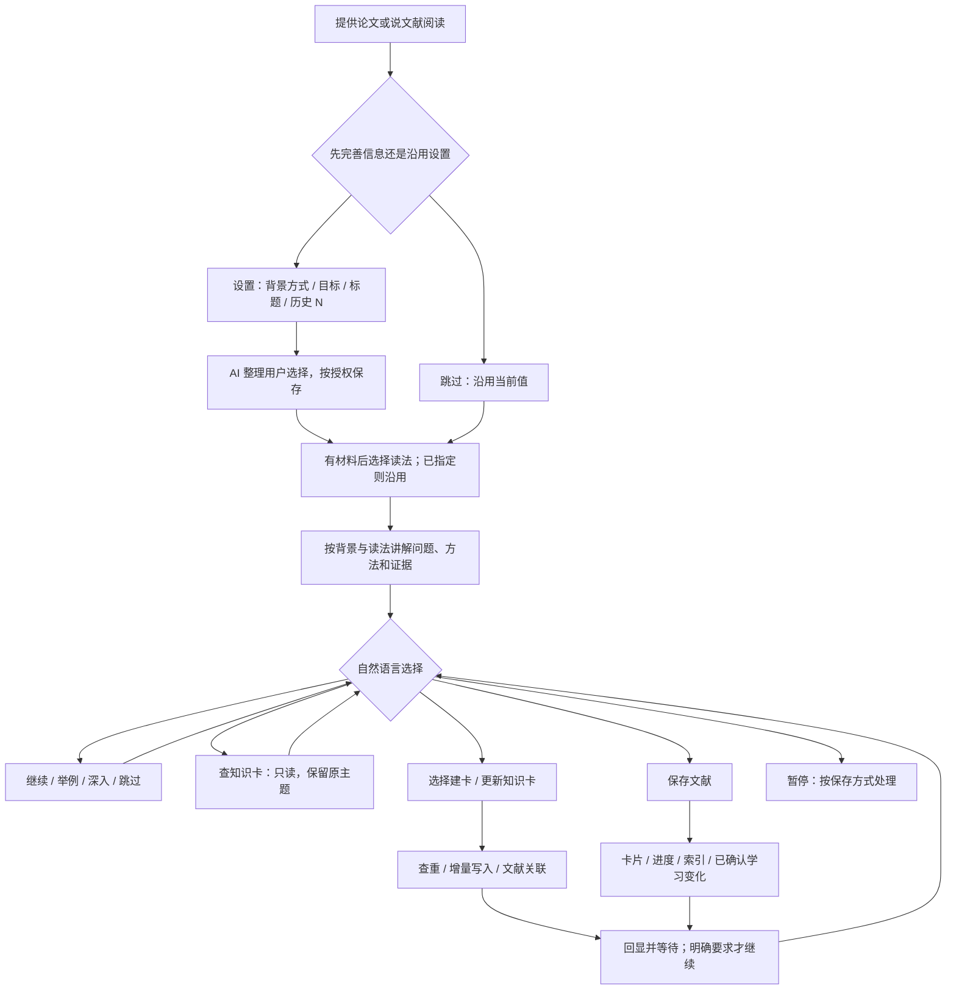

# 设计说明

入口维护共同规则和资源路由。文献保存、知识查阅/写入/关联、成长和深入阅读均按需加载，复用上下文；更新旧卡不重读模板，无学习变化不加载成长规则。

配置保存偏好及学习状态；文献索引和文献卡维护论文及恢复进度；知识索引和知识卡维护可复用解释。已有卡双向链接，未建文献卡只记真实来源，不提前生成空卡或无效链接。

背景问答可选，默认从阅读互动了解，均由 AI 整理。问答建档回答可直接写入；普通阅读反馈先在会话内生效，保存或明确更新时持久化。能力不由篇数或所读论文推断，建知识卡不代表掌握。验证范围见 [审阅记录](interaction-review.md)。

## 缓存清理与保存的关系

自动清理独立于保存模式，只在结束/换篇且完整保存成功后触发，不扩大保存授权。遵循“准确生成清单 → 路径边界核验 → 引用检查 → 逐文件清理 → 结果回显”；不推断旧文件归属，不定时扫描目录。规则集中在 output-format.md，saving.md 和 save-policy.md 仅路由，不重复维护删除逻辑。
